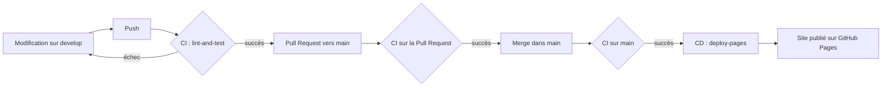

# Pipeline CI/CD pour un projet web

[](https://github.com/GuyMartial24/repo_test_html/actions/workflows/CI_CD_pipeline.yml)

**Auteur :** Martial GADJEU | Data Engineer & AI

## Présentation

Ce dépôt est un projet de démonstration. L'objectif est de montrer comment mettre en place un pipeline **CI/CD** (intégration continue et déploiement continu) pour un site web statique, avec **GitHub Actions** et **GitHub Pages**.

- À chaque modification du code, des contrôles automatiques vérifient le HTML, le CSS et les liens internes (**CI**).
- Si ces contrôles réussissent, le site est publié automatiquement sur GitHub Pages (**CD**), uniquement pour la branche `main`.

Le site publié est la page `index.html` de ce dépôt : https://guymartial24.github.io/repo_test_html/

## Fonctionnement

Le pipeline est défini dans le fichier [`.github/workflows/CI_CD_pipeline.yml`](.github/workflows/CI_CD_pipeline.yml). Il se déclenche :

- à chaque `push` sur `main` ou `develop` ;
- à chaque Pull Request vers `main`.

Le schéma ci-dessous résume le parcours d'une modification :



| Événement | CI (`lint-and-test`) | CD (`deploy-pages`) |
|-----------|:--------------------:|:-------------------:|
| Push sur `develop` | Oui | Non |
| Pull Request vers `main` | Oui | Non |
| Push ou merge sur `main` | Oui | Oui, si la CI réussit |

## Les jobs

### 1. `lint-and-test` : intégration continue

Ce job vérifie le code avant qu'il ne soit publié.

| Étape | Rôle |
|-------|------|
| `actions/checkout@v4` | Récupère le code du dépôt |
| `actions/setup-node@v4` | Installe Node.js 20 |
| `actions/cache@v4` | Met en cache le dossier npm entre deux exécutions |
| Installation des linters | Installe HTMLHint et Stylelint avec npm |
| Vérification des fichiers | Contrôle que `README.md` existe |
| `htmlhint "**/*.html"` | Analyse tous les fichiers HTML. Une erreur fait échouer le pipeline |
| `stylelint "**/*.css"` | Analyse les fichiers CSS s'il y en a. Sinon, l'étape est ignorée |
| `lycheeverse/lychee-action@v2` | Vérifie que les liens internes des pages HTML pointent vers des cibles existantes |

Les liens externes ne sont pas testés. Un site tiers temporairement indisponible ferait échouer la CI sans raison liée au projet.

### 2. `deploy-pages` : déploiement continu

Ce job publie le site sur GitHub Pages.

| Étape | Rôle |
|-------|------|
| `needs: lint-and-test` | Le déploiement ne se lance que si la CI a réussi |
| `if: github.ref == 'refs/heads/main' && github.event_name == 'push'` | Le déploiement ne concerne que la branche `main` |
| `actions/configure-pages@v5` | Configure GitHub Pages |
| `actions/upload-pages-artifact@v3` | Prépare le site sous forme d'artefact |
| `actions/deploy-pages@v4` | Publie le site. L'URL est disponible dans l'environnement `github-pages` |

## Bonnes pratiques appliquées

- **Blocage si la CI échoue** : un code qui ne passe pas les contrôles n'est jamais publié.
- **Permissions minimales** : le `GITHUB_TOKEN` n'a que les droits nécessaires (`contents: read`, `pages: write`, `id-token: write`).
- **Pas de déploiements simultanés** : le groupe `concurrency: pages` évite que deux déploiements se chevauchent.
- **Environnement de déploiement** : le déploiement passe par l'environnement `github-pages`, ce qui permet de suivre chaque mise en ligne.
- **Organisation Git** : le travail se fait sur `develop`, la production est `main`, et les changements passent par une Pull Request.
- **Actions versionnées** : les actions officielles sont appelées avec une version précise.

## Workflow Git

1. Je travaille sur la branche `develop` et je pousse mes changements. La CI vérifie le code.
2. J'ouvre une Pull Request de `develop` vers `main`. La CI se relance.
3. Je fusionne la Pull Request. La CI tourne sur `main`, puis le site est déployé.

## Structure du projet

```text
repo_test_html/
├── .github/
│   └── workflows/
│       └── CI_CD_pipeline.yml   # Définition du pipeline
├── .gitignore
├── index.html                   # Page publiée sur GitHub Pages
└── README.md
```

## Lancer la vérification en local

Avant de pousser, on peut reproduire les contrôles HTML et CSS :

```bash
npm install -g htmlhint stylelint stylelint-config-standard
htmlhint "**/*.html"
stylelint "**/*.css" --config '{"extends": "stylelint-config-standard"}'
```

Pour voir la page, il suffit d'ouvrir `index.html` dans un navigateur.

## Pistes d'amélioration

Ces points ne sont pas encore en place. Ce sont les prochaines étapes que je prévois :

- Protéger la branche `main` pour exiger une Pull Request et une CI réussie avant tout merge.
- Tester aussi les liens externes, avec un contrôle séparé pour ne pas bloquer la CI.
- Ajouter un `package.json` pour que le cache npm soit lié aux dépendances réelles.

## Technologies

HTML5 · CSS3 · Git · GitHub · GitHub Actions · GitHub Pages · HTMLHint · Stylelint · Lychee · Node.js / npm · YAML

## Auteur

**Martial GADJEU** : Data Engineer & AI
GitHub : [GuyMartial24](https://github.com/GuyMartial24)
